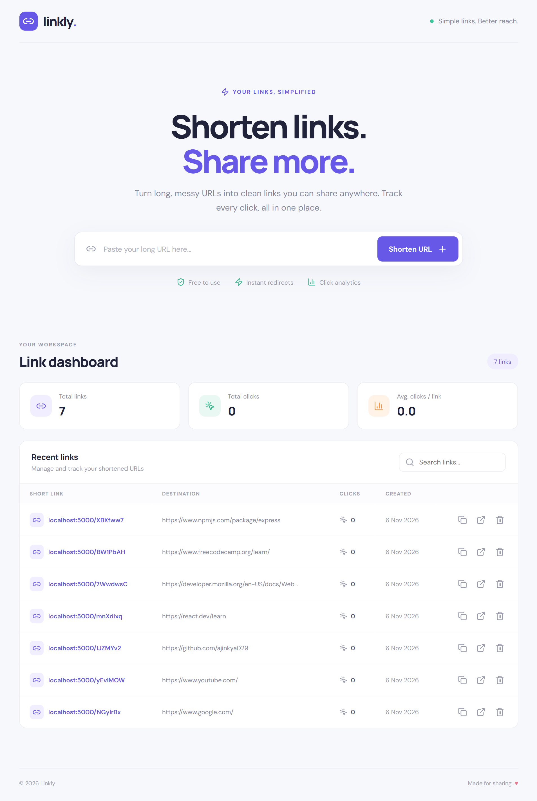

# 🔗 MERN URL Shortener

<p align="center">
  
  
  
  
  
  
</p>

A full-stack **URL Shortener Application** built using the MERN stack (MongoDB, Express.js, React.js, and Node.js). It allows users to convert long URLs into short, shareable links and track their click activity through a clean and responsive dashboard.

## 📸 Screenshots

### Dashboard
<!-- Replace with your actual screenshot -->



## ✨ Features

- **Shorten URLs:** Convert long URLs into short, unique links.
- **Unique Short Codes:** Generate unique 7-character short IDs.
- **URL Redirection:** Automatically redirect users to the original URL.
- **Click Tracking:** Track the number of clicks on each shortened URL.
- **Analytics Dashboard:** View total URLs and total clicks.
- **Search URLs:** Easily find shortened links.
- **Copy to Clipboard:** Copy shortened URLs with one click.
- **Delete URLs:** Remove shortened links when no longer needed.
- **Responsive Design:** Works across desktop, tablet, and mobile devices.
- **URL Validation:** Validate URLs before creating short links.
- **Rate Limiting:** Protect API endpoints against excessive requests.

## 🛠️ Tech Stack

**Frontend**
- React.js
- Vite
- CSS3

**Backend**
- Node.js
- Express.js
- REST API

**Database**
- MongoDB
- Mongoose

**Other Tools & Libraries**
- Nanoid – Unique short URL generation
- Nodemon – Development server
- Git & GitHub – Version control

## 📁 Project Structure

```text
mern-url-shortener/
│
├── backend/
│   ├── config/
│   ├── controllers/
│   ├── models/
│   ├── routes/
│   ├── middleware/
│   ├── server.js
│   └── .env.example
│
├── frontend/
│   ├── public/
│   └── src/
│       ├── components/
│       ├── pages/
│       ├── services/
│       ├── App.jsx
│       └── main.jsx
│
├── package.json
└── README.md
```

## ⚙️ Installation & Setup

### 1. Clone the Repository

```bash
git clone https://github.com/YOUR_USERNAME/mern-url-shortener.git
cd mern-url-shortener
```

### 2. Install Dependencies

```bash
npm install
npm run install:all
```

### 3. Configure Environment Variables

Create a `.env` file inside the `backend` directory.

```env
PORT=5000
MONGODB_URI=mongodb://127.0.0.1:27017/url-shortener
BASE_URL=http://localhost:5000
```

Update the values according to your environment.

### 4. Start the Application

```bash
npm run dev
```

The application will be available at:

- **Frontend:** http://localhost:5173
- **Backend:** http://localhost:5000

Make sure MongoDB is running before starting the backend.

## 🔌 API Endpoints

| Method | Endpoint | Description |
|---|---|---|
| POST | `/api/urls` | Create a short URL |
| GET | `/api/urls` | Get all URLs |
| GET | `/api/urls/:id` | Get URL details |
| DELETE | `/api/urls/:id` | Delete a URL |
| GET | `/:shortCode` | Redirect to original URL |

## 📊 How It Works

1. Enter a long URL in the input field.
2. The frontend sends a request to the backend API.
3. The backend validates the URL and generates a unique short code.
4. The shortened URL is saved in MongoDB.
5. The user receives a short, shareable URL.
6. When someone visits the short URL, the backend redirects them to the original URL.
7. Click statistics are updated in the database.

## 🚀 Future Improvements

- User authentication and authorization.
- Custom short URL aliases.
- QR code generation.
- URL expiration functionality.
- Advanced analytics and click history.
- Geographic click statistics.
- User-specific URL management.

## 👨‍💻 Author

**Ajinkya Dhatrak**

GitHub: [@ajinkya029](https://github.com/ajinkya029)

## ⭐ Support

If you find this project useful, consider giving it a ⭐ on GitHub!

---

<p align="center">
  Made with ❤️ using the MERN Stack
</p>